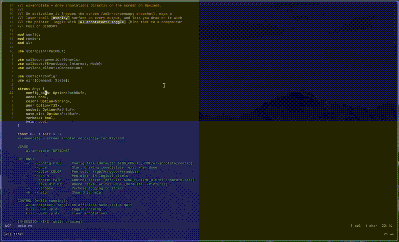

# wl-annotate

Draw annotations directly on the screen on Wayland.



Press a key, the screen freezes, draw with the mouse, press `q` to finish. `wl-annotate` captures a screencopy snapshot of every output and shows it as a fullscreen layer-shell overlay — you draw on the overlay, not in a window.

## Requirements

- A wlroots-based compositor supporting `zwlr_layer_shell_v1` and `zwlr_screencopy_manager_v1` (niri, Sway, Hyprland, labwc, Wayfire, river).
- No special permissions needed. GNOME and KDE are not supported.

## Installation

```sh
cargo install wl-annotate
```

Or from source

```sh
git clone https://github.com/EnricoDev1/wl-annotate.git
cd wl-annotate
cargo install --path .
```

Both binaries are installed to `~/.cargo/bin`:

| Binary | Role |
|---|---|
| `wl-annotate` | Long-lived daemon that owns the overlays and listens on a Unix socket |
| `wl-annotatectl` | Small client used from compositor keybinds |

## Usage

Start the daemon with your session (systemd unit is provided in `dist/`):

```sh
cp dist/wl-annotate.service ~/.config/systemd/user/
systemctl --user enable --now wl-annotate.service
```

Bind a key to toggle drawing, e.g. in niri:

```kdl
Mod+D { spawn "wl-annotatectl" "toggle"; }
```

Or run it without a daemon:

```sh
wl-annotate --once
```

### Controls

| Input | Action |
|---|---|
| Left drag | Draw |
| Mouse wheel | Change pen size |
| `r` `b` `g` `m` `w` | Pen color |
| `u` | Undo (last drag or clear) |
| `Shift+u` | Redo |
| `c` / right click | Clear annotations |
| `s` | Save PNG snapshot(s) |
| `q` / `Esc` | Stop drawing |
| `wl-annotatectl` | `toggle`, `on`, `off`, `clear`, `save`, `status`, `quit` |
| `SIGUSR1` / `SIGUSR2` | Toggle / clear |

## Configuration

Optional config file at `~/.config/wl-annotate/config`:

```ini
color    = #ff0000
pen_size = 4
socket   = ~/run/wl-annotate.sock
save_dir = ~/Pictures
```

CLI flags override the file:

```sh
wl-annotate --color '#00ff00' --pen 6 --once -v
```

## Development

```sh
cargo test
cargo build --release
```

The `examples/` directory contains development-only input injectors for testing against a live compositor.

## License

MIT. See [LICENSE](LICENSE).
